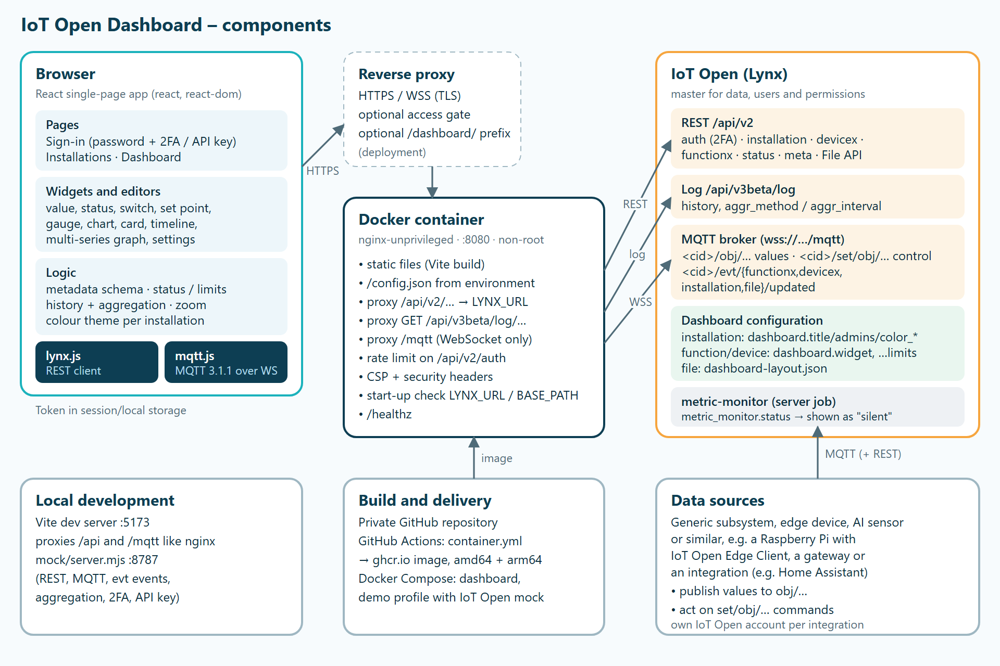

# IoT Open Dashboard

A generic, configurable dashboard on top of [IoT Open](https://iotopen.se) (Lynx). It shows one dashboard per installation, and **everything it shows is configured in IoT Open itself**: simple settings as metadata on installations, devices and functions, and the layout as a JSON file in the installation's File API.

The app has **no backend and no database of its own**:

- **Sign-in, users and permissions** are IoT Open's. Two ways to sign in:
  - *Username (E-mail) and password* via `POST /api/v2/auth`, with two-factor authentication. IoT Open answers with `next_step` and a temporary token, and the code is sent with `PUT /api/v2/auth`. Such a session can expire.
  - *API key* created under the user in IoT Open. It is used directly as `X-API-Key` (and as the MQTT password), checked with `GET /api/v2/user/me`, and does not expire. This suits a wall screen. Signing out does not call `DELETE /auth` for an API key, so the key stays valid in IoT Open.
  - *Direct link* (e.g. a QR code for visitors): `https://<dashboard>/#/i/<installation id>?token=<API key>` (or just `#token=<API key>`) signs in with that API key and opens the installation. The key stays after the `#`, so it is never sent to the server, and it is removed from the address bar at once and kept in `sessionStorage` only. Use a key for a user with read-only access to that installation, and delete the key in IoT Open when it should stop working.
  - With *Remember me* (*Kom ihåg mig*) the token is kept in the browser's `localStorage`, otherwise in `sessionStorage` for the tab only.
- **Server**: the sign-in page shows which IoT Open server is used (*Server: lynx.iotopen.se*). The default is the container's `LYNX_URL`. With *Change* (*Ändra*) the user can type another server, e.g. `lynx.example.com`. After a successful sign-in that address is saved in this browser (`localStorage`) and used until the user changes it or chooses *Default* (*Standard*). Only `https://` addresses without a path are accepted (plain `http://` only for `localhost`). The default server is reached through the container's proxy; another server is called directly from the browser, which works because IoT Open allows CORS. `CUSTOM_SERVERS=false` turns the choice off.
- **Live values** arrive over MQTT on a WebSocket (`/mqtt`) with the same token. Without MQTT everything is re-read over REST every 30 s. The header shows *Live* (green) or *Polling*.
- **Changes in IoT Open** (devices, functions, installation metadata, files) arrive as `<client_id>/evt/<type>/updated` events, so nothing is polled while MQTT is connected.
- **Control**: switches, set points and dimmers publish to `<client_id>/<topic_write>` (topics starting with `set/obj/…`).
- **Container**: nginx (non-root, port 8080). It serves the app and, by default (`API_MODE=proxy`), proxies `/api/*` and `/mqtt` to one fixed IoT Open address (`LYNX_URL`), so with the default server the browser only talks to its own origin. With `API_MODE=direct` the browser talks to `LYNX_URL` itself and the container only serves the app, see [Proxy or direct](#proxy-or-direct).

See [SECURITY.md](SECURITY.md) for the security model and deployment checklist.

> The user interface is in Swedish. UI labels in this document are given in English with the Swedish label in parentheses.

## Architecture



- **Browser**: the React app talks REST (`lynx.js`) and MQTT over WebSocket (`mqtt.js`) to its own origin, or directly to another IoT Open server chosen on the sign-in page.
- **Reverse proxy** (optional, part of the deployment): TLS, an access gate and an optional sub-path.
- **Container**: nginx serves the built app and, in the default proxy mode, proxies `/api/v2`, `/api/v3beta/log` and `/mqtt` to one fixed IoT Open address.
- **IoT Open (Lynx)** is the master for data, users, permissions and the dashboard configuration (metadata and `dashboard-layout.json`).
- **Data sources** are whatever feeds the installation: a generic subsystem, an edge device, an AI sensor or similar, for example a Raspberry Pi with the [IoT Open Edge Client](https://lynx.iotopen.se/tech/guides/gateways/raspberrypi/), a gateway or an integration such as Home Assistant. They publish values to `obj/…` and act on `set/obj/…`. The dashboard never talks to them directly.

## Getting started

```bash
# Production
docker build -t iotopen-dashboard .
docker run -p 8080:8080 -e LYNX_URL=https://lynx.iotopen.se iotopen-dashboard

# Fully local demo against a mock of IoT Open
docker compose --profile demo up --build     # http://localhost:8081  demo@example.com / demo

# Development
npm install
npm run dev:mock          # mock API + MQTT on :8787
npm run dev               # Vite on :5173, proxies /api and /mqtt to the mock
LYNX_URL=https://lynx.iotopen.se npm run dev   # against a real instance (PowerShell: $env:LYNX_URL="https://lynx.iotopen.se"; npm run dev)
```

The mock (`mock/server.mjs`, no dependencies) implements the parts of the IoT Open API the dashboard uses, including MQTT (with `+`/`#` wildcards and a few topics without functions for the MQTT widget), `evt/*` events, aggregation and the rejection of empty metadata values. Test logins: `demo@example.com` / `demo`, API key `demo-api-key`, and `twofa@example.com` / `demo` with code `123456`.

> If the project folder is in a synced folder (Nextcloud, OneDrive …), run `npm install` in a copy outside it so `node_modules` is not synced.

### Building the container on GitHub

`.github/workflows/container.yml` builds the image for amd64 and arm64 and publishes it to GitHub Container Registry:

- a push to `main` gives `ghcr.io/<owner>/<repo>:main` and `:sha-<short>`
- the tag `v1.2.3` gives `:1.2.3`, `:1.2` and `:latest`
- pull requests are built but not published

The version shown centred at the bottom of the page comes from the build argument `APP_VERSION`: the tag for a release, and the latest release tag for builds of `main` and pull requests. Local builds without it use `version` in `package.json`.

```bash
docker run -d -p 8080:8080 -e LYNX_URL=https://lynx.iotopen.se ghcr.io/<owner>/<repo>:latest
```

If the repository is private the package is private too. Then `docker login ghcr.io` with a token that has `read:packages` is needed, or the package can be made public under *Package settings* on GitHub.

### Environment variables (container)

| Variable                  | Default                   | Meaning                                                                                                                                                         |
|---------------------------|---------------------------|-----------------------------------------------------------------------------------------------------------------------------------------------------------------|
| `LYNX_URL`                | `https://lynx.iotopen.se` | IoT Open instance that `/api` and `/mqtt` are forwarded to                                                                                                      |
| `ALLOWED_LYNX_HOSTS`      | `lynx.iotopen.se`         | Allowed host names for `LYNX_URL`. The container refuses to start otherwise                                                                                     |
| `ALLOW_INSECURE_LYNX_URL` | `false`                   | `true` allows `http://` (only for the local demo)                                                                                                               |
| `APP_TITLE`               | `Dashboard`               | Name next to the IoT Open logo in the header and on the sign-in page                                                                                            |
| `LIVE_UPDATES`            | `true`                    | `false` turns MQTT off; only polling is used                                                                                                                    |
| `BASE_PATH`               | *(empty)*                 | Path prefix the container itself serves under, e.g. `/dashboard` (no trailing slash). Only needed when a reverse proxy forwards the prefix unchanged, see below |
| `CUSTOM_SERVERS`          | `true`                    | `true` lets users type another IoT Open server on the sign-in page (saved in their browser; the CSP then allows `https:`/`wss:` connections). `false` = only `LYNX_URL` |
| `MAP_TILES`               | `https://tile.openstreetmap.org/{z}/{x}/{y}.png` | Map tiles for the *Tracker* widget: an `https://` URL template with `{z}`, `{x}` and `{y}`. Its origin is added to the CSP `img-src`. Empty = no map background (only the tracks are drawn). For heavy use, run or rent a tile server rather than using OpenStreetMap's public one, see their [tile usage policy](https://operations.osmfoundation.org/policies/tiles/) |
| `MAP_ATTRIBUTION`         | `© OpenStreetMap-bidragsgivare` | Attribution shown in the corner of the map                                                                                                                 |
| `API_MODE`                | `proxy`                   | `proxy`: the browser talks to this container, which relays `/api` and `/mqtt` to `LYNX_URL`. `direct`: the browser talks to `LYNX_URL` itself and the container only serves the app (`/api` and `/mqtt` answer 404) |

### Proxy or direct

With `API_MODE=proxy` (default) the browser only talks to the dashboard's own origin and nginx relays API and MQTT traffic to `LYNX_URL`. This works where browsers can reach the dashboard but not IoT Open, and IoT Open only sees the server's address.

With `API_MODE=direct` the browser calls `LYNX_URL` itself, exactly as it does for a server typed on the sign-in page. TLS then runs end to end between the browser and IoT Open: passwords, tokens, API keys and MQTT traffic do not pass through the container or through a TLS-terminating proxy or tunnel in front of it (for example a CDN or Cloudflare Tunnel), and IoT Open applies its own rate limits per user. It requires that the browser can reach `LYNX_URL` and that IoT Open allows CORS from the dashboard's origin, which it does today. With `CUSTOM_SERVERS=false` the CSP `connect-src` then allows exactly `'self'` and `LYNX_URL` (https and wss).

```yaml
    environment:
      LYNX_URL: https://lynx.iotopen.se
      API_MODE: direct
      CUSTOM_SERVERS: "false"   # optional: only LYNX_URL, narrowest CSP
```

### Running under a sub-path

The app only uses URLs relative to the directory it is served from (API, MQTT, `config.json`, assets, images), so the same image works at `https://host/` and at `https://host/dashboard/`. The health check is always `/healthz`.

- **Reverse proxy strips the prefix** (most common) – nothing to configure:

  ```nginx
  location /dashboard/ {
      proxy_pass http://dashboard:8080/;          # trailing slash: /dashboard/x -> /x
      proxy_http_version 1.1;
      proxy_set_header Upgrade $http_upgrade;     # MQTT over WebSocket
      proxy_set_header Connection "upgrade";
      proxy_read_timeout 3600s;
  }
  ```
- **Reverse proxy keeps the prefix** – set `BASE_PATH=/dashboard`. The container then serves everything under `/dashboard/` and removes the prefix before forwarding to IoT Open.

The page needs the trailing slash (`/dashboard/`). With `BASE_PATH` the container redirects `/dashboard` to `/dashboard/`; behind a prefix-stripping proxy, let the proxy do that redirect (e.g. `location = /dashboard { return 301 /dashboard/; }`).

### Local dashboard on the edge client

The edge app [Local dashboard](https://github.com/automateit-se/edge-app-local-dashboard) serves this dashboard on the installation's local network, also without internet. It uses the same code, built as one self-contained HTML file: `npm run build:local` writes `dist-local/iotopen-dashboard-local.html` (scripts, styles and logos inlined), and every release gets that file attached by the `local` workflow. The app downloads it when it starts.

In the app, `/config.json` has a `local` section, which switches the dashboard to local mode:

- one installation, no sign-in to IoT Open and no list of installations; editing is hidden (the dashboard is edited in the cloud),
- the app acts as a read-only IoT Open for the installation (REST and MQTT over WebSocket), so widgets work as in the cloud,
- the pages, the start page and the widget types that are shown can be chosen per app instance, and a kiosk mode hides the header,
- access as set on the app: open, a PIN for control (*Lås upp* in the header) or a password for everything,
- the footer says whether the app can reach IoT Open, and the *Live* badge turns into a yellow *Lokalt* when it cannot: the screen is connected, but only to what is on the installation (values and control), with the history the app has kept.

## Configuration in IoT Open

### On the installation (metadata)

| Key                                   | Meaning                                                                                                                                                                           |
|---------------------------------------|-----------------------------------------------------------------------------------------------------------------------------------------------------------------------------------|
| `dashboard.title`                     | Dashboard heading. Empty = the installation's name                                                                                                                                |
| `dashboard.admins`                    | Who may edit: user ids or e-mail addresses, comma separated. Empty = everyone. This only controls the editing UI; IoT Open still rejects writes the account has no right to (403) |
| `dashboard.color_primary`             | Primary colour: header, headings, selected buttons. Default `#0D3E53`                                                                                                             |
| `dashboard.color_widget`              | Default widget colour and "on" state in timelines. Default = primary colour (light blue `#B4DBEA` in dark mode)                                                                   |
| `dashboard.color_accent`              | Primary buttons (*Klar*, *Spara*, *Logga in*). Default `#F6A53E`                                                                                                                  |
| `dashboard.color_header`              | Header background. Default = primary colour                                                                                                                                       |
| `dashboard.color_title`               | Colour of the installation title at the top of the dashboard. Default = primary colour, light mode                                                                                |
| `dashboard.color_background`          | Page background (light mode). Default `#EDF6FA`                                                                                                                                   |
| `dashboard.color_warning`             | Tile colour at status 1 (Warning). Default `#F6A53E`                                                                                                                              |
| `dashboard.color_critical`            | Tile colour at status 2 (Critical). Default `#D32F2F`                                                                                                                             |
| `dashboard.color_info_background`     | Info box background (e.g. the edit-mode hint). Default `#EDF6FA`, light mode                                                                                                      |
| `dashboard.color_info_text`           | Info box text. Default = primary colour, light mode                                                                                                                               |
| `dashboard.color_range_background`    | Frame around the time range buttons (1 h, 24 h …). Default `#E2EFF5`, light mode                                                                                                  |
| `dashboard.color_range_text`          | Text of buttons that are not selected. Default `#4F6B78`, light mode                                                                                                              |
| `dashboard.color_range_selected`      | Background of the selected range. Default white, light mode                                                                                                                       |
| `dashboard.color_range_selected_text` | Text of the selected range. Default `#0D2E3D`, light mode                                                                                                                         |

All colours can be edited in the dashboard under *Edit → Settings* (*Redigera → Inställningar*, with a colour picker), or directly in Lynx. Values must be valid CSS colours; anything else is ignored. An empty field removes the key and restores the default.

### On a function or device (metadata)

A function or device appears on the dashboard when it has `dashboard.widget`. Everything can be set in the dashboard's edit mode or directly in Lynx.

| Key                  | Values                                                                                                                                                                                                                                          |
|----------------------|-------------------------------------------------------------------------------------------------------------------------------------------------------------------------------------------------------------------------------------------------|
| `dashboard.widget`   | Function: `value`, `chart`, `gauge`, `switch`, `status`, `number`, `button`, `consumption`, `sum`. Device: `card`. Several types comma separated, e.g. `switch,button`, give one widget each. Empty = not shown                                                         |
| `dashboard.nickname` | Display name. Empty = `meta.name`                                                                                                                                                                                                               |
| `dashboard.color`    | Any CSS colour, e.g. `#0f766e`                                                                                                                                                                                                                  |
| `dashboard.icon`     | Icon name: `bolt`, `thermometer`, `droplet`, `power`, `lightbulb`, `gauge`, `door`, `lift`, `wind`, `home`, `chart`, `alert`, `sun`, `fan`, `lock`, `signal`, `battery`, `device`, `bell`, `link`, `map`. Empty = IoT Open's standard `icon` key if it is one of these |
| `dashboard.timeline` | Name of a timeline. All functions with the same name become rows in one timeline widget                                                                                                                                                         |
| `dashboard.chart`    | Name of a multi-series graph. All functions with the same name are drawn as lines in one graph                                                                                                                                                  |
| `dashboard.tracker`  | Name of a map (*Tracker*). All functions with the same name are drawn on one map, one track per device                                                                                                                                         |
| `dashboard.limits`   | Limits for status OK / Warning / Critical, e.g. `-w<18,>21 -c<16,>22` (see below)                                                                                                                                                               |
| `dashboard.color_<x>` | Colour for the state `state_<x>`, e.g. `dashboard.color_armed = #dc2626`. Fills a *value* widget, colours the dot of a *status* widget                                                                                                         |
| `dashboard.press`    | *button*: value sent to `topic_write` while the button is pressed. Empty = `1`                                                                                                                                                                  |
| `dashboard.release`  | *button*: value sent when the button is released. Empty = nothing is sent                                                                                                                                                                       |
| `dashboard.press_msg` / `dashboard.release_msg` | *button* (under *Avancerat*): text sent as `msg` together with the value when pressed / released |
| `dashboard.on_msg` / `dashboard.off_msg` | *switch* (under *Avancerat*): text sent as `msg` when switched on / off |
| `dashboard.topic`    | *switch* / *button* (under *Avancerat*): where to publish instead of `topic_write`. Either the name of one of the function's `topic_*` keys (e.g. `topic_write_2`) or a topic without the client id (e.g. `set/obj/gate/1`) |

The dashboard also reads IoT Open's standard function metadata ([meta keys](https://lynx.iotopen.se/tech/docs/platform/devxfuncx/meta-keys.html)): `name`, `format`, `unit`, `icon`, `visible`, `topic_read`, `topic_write`, `topic_read_onoff`, `topic_write_onoff`, `min`, `max`, and the `state_<x>` / `text_<x>` pairs (`on`/`off`, `open`/`closed`, `true`/`false`, `movement`/`nomovement` …).

**Several widgets per function.** `dashboard.widget = switch,button` shows the same function as both a switch and a push button. Name, icon, limits and states are shared; size, order and colour are per widget. With several widgets the colour is stored per widget in the layout file, and `dashboard.color` is the fallback. Removing one widget takes its type out of the list.

**Extra widgets of the same type.** A function can also get several widgets of the same type, e.g. four push buttons on one function that send 10, 20, 73 and 94. Pick the function again in *Add widget* and choose a type it already has: the new widget is stored only in the layout file under `x:<n>` with `type` and `ref` (`f:<function id>` or `d:<device id>`). Its own `label`, `icon`, `color`, `press`, `release`, `press_msg`, `release_msg`, `on_msg`, `off_msg` and `topic` are laid over the function's metadata, so name, icon, colour and control settings apply only to that widget, while limits and states are still read from the function. If the function is deleted in IoT Open the widget is shown as *Saknas* in edit mode and can be removed.

**Pages.** The dashboard can be split into pages, e.g. *Energi* or *Omsorg*, shown as tabs above the widgets. In edit mode *Ny sida* creates a page and the cog edits the current one: name, icon and its own base colours (empty = the installation's colours). The arrows move the page left or right. Each page has its own address, `#/i/<installation id>/p/<page id>`, so it can be bookmarked; the first page is `#/i/<installation id>`. A widget is moved to another page with the page menu in its header in edit mode. Removing a page moves its widgets to the first page. A link button can go to a page instead of a web address (*Knappen går till → Sida i dashboarden*). Pages are stored in the layout file, so they apply to everyone who opens the installation.

**Background image per page.** In the page editor (*Bakgrundsbild*) a page can get its own image behind the widgets, e.g. a photo of the building. The image is scaled down in the browser to at most 1920 px and saved as JPEG (at most 600 kB, usually 100-400 kB) in the file `dashboard-bg-<page id>.jpg` on the installation. With an image the widgets turn to glass: dark, translucent tiles with white text, and the title and tabs are drawn in white over the image. Settings per page: *Mörkläggning* (a dark layer over the image, 0-80 %; a value is suggested from the image's brightness so that white text stays readable), *Widgetarnas täckning* (10-60 %, lower = more of the image shows through), *Glaseffekt* (the image is blurred behind each widget) and *Gör hela bilden suddig*. Warning and Critical keep their colours, slightly translucent. *Ta bort bilden* deletes the file and the page looks as before. The page editor shows a preview before anything is saved.

*Add widget* (*Lägg till widget*) lists all functions and the devices without a card, grouped per device; a function that already has widgets is marked with its types and can get another one: click a device to open it and pick one of its functions, or the whole device as a card. Search shows only the devices with a matching function (or a matching name). The miniatures of the widget types narrow the list to what fits, e.g. *Brytare* shows only functions with `topic_write` and on/off states.

**IoT Open is the master.** An object with `visible = "0"` or `"false"` is hidden everywhere in the dashboard: widgets, card rows, timelines, graphs and the *Add widget* lists. In edit mode hidden widgets stay visible, dimmed and marked *Hidden* (*Dold*). A missing `visible` means visible.

### Widget types

- **value**: the latest value, formatted with the function's `format` and `unit`. Discrete values use the `state_<x>`/`text_<x>` pairs, e.g. `state_closed = 0`, `text_closed = Closed`. With `dashboard.color_<x>` the whole tile is filled with the colour of the current state, and with height 0.5 it becomes a **banner**, e.g. across the top of the dashboard: `state_armed = 2`, `text_armed = Larmat`, `dashboard.color_armed = #dc2626`. The widget editor has a table for these states (value, text, colour).
- **status**: like *value*, plus a dot showing the state (coloured when active – on, open, movement – grey otherwise, or the state's `dashboard.color_<x>`). Best for doors, alarms and motion.
- **button** (*Tryckknapp*): a momentary push button, e.g. a door bell. Sends `dashboard.press` (default 1) to `topic_write` when pressed and, if set, `dashboard.release` when released. Works with mouse, touch and keyboard. Under *Avancerat* in the editor a switch or button can also send a message (`msg`) with the value and publish to another of the function's topics, or a topic of your own.
- **Link button**: a button that opens another web page (http/https only) or another page of the dashboard. Created with *Add widget → New link button* (*Ny länkknapp*). It has no device or function behind it, so it is stored only in the layout file under `u:<n>` (`url` or `target_page`, `label`, `newTab`, `icon`, `color`).
- **MQTT**: shows what arrives on any topic of the installation, also topics that have no function in IoT Open (e.g. a sensor publishing its own JSON). Created with *Add widget → New MQTT widget* (*Ny MQTT-widget*) and stored only in the layout file as `m:<n>`. The topic is given without the client id; the dashboard puts `<client_id>/` in front, so a widget can only subscribe inside the open installation. `+` matches one level and `#` everything below (`sensor/+/temp`, `lab/#`). Four modes: *Värde* (the latest value, or a field of a JSON message given as a path such as `data.temp` or `values.0`; with unit, decimals and a text and colour per value - the colour fills the tile, so with height 0,5 it becomes a banner), *JSON* (the whole latest message, indented), *Logg* (the latest messages with time, `rows`, at most 50) and *Tabell* (one row per topic with its latest value, for wildcards, at most 50 rows). Without `path`, an IoT Open style message (`{"value": …, "timestamp": …}`) shows its `value`, anything else the whole message. A retained message is shown at once; otherwise the widget says *Väntar på data* until something arrives. There is no history, since IoT Open only keeps history for functions - for a graph, create a function for the topic in IoT Open. The widget is read only (it never publishes), shows everything as plain text, and needs the live MQTT connection (not with `LIVE_UPDATES=false`). What it can read is decided by IoT Open's broker for the signed-in token.
- **Text**: a note about the dashboard, e.g. what is relevant right now. Created with *Add widget → New text widget* (*Ny textwidget*) and stored only in the layout file as `n:<n>` (`text`, `label`, `size`, `bold`, `italic`, `color`). The editor has a heading (empty = no heading, only the text), the text (line breaks are kept, at most 2,000 characters), the text size (*Liten*, *Normal*, *Stor*, *Mycket stor*), bold and italic, and a preview. The text is shown as plain text, never as HTML. With height 0,5 it becomes a one-line banner.
- **switch**: a toggle that publishes the "on"/"off" state value (`state_on`/`state_off`, or the matching pair, default 1/0) to `topic_write`, or `topic_write_onoff` when present.
- **number**: publishes a number to `topic_write`. With `min`/`max` it becomes a slider (e.g. a dimmer 0–100); with `topic_write_onoff` an on/off toggle is added.
- **gauge**: a half circle between `min` and `max` (from the layout file). An empty `max` is automatic: the function's own `min`/`max` in IoT Open when it has them, 100 for a percentage (`%` in `format` or `unit`), otherwise a round number above the value (911 gives 1000), so a counter that grows still fits. A value outside the scale is drawn with a dashed arc.
- **chart**: a graph of the history from the log, extended with live values. The y axis runs between round numbers and does not go below zero when no value is negative (a counter starts at 0, not at -67.8). Hovering shows the time and value in a small box over the graph, so nothing moves.
- **card** (on a device): all functions whose `meta.device_id` is the device's id. Switches and set points can be controlled in the card.
- **media** (*Media*, on a device): a media player, e.g. a speaker mirrored from Home Assistant. The device's functions are found by the last part of `topic_read` (`<base>/playing`, `volume`, `mute`, `state`, `power`) or else by a name ending in *Uppspelning*, *Volym*, *Mute*, *Status* or *På/av*. The widget shows the current track from the `msg` of *Uppspelning* (`Artist – Titel`, the text before ` – ` is shown as the artist), the state (`playing`, `paused`, `idle`, `off`, `unavailable` … in Swedish) and buttons for on/off, play/pause and mute plus a volume slider. Only the controls the device has functions for are shown; they publish to each function's `topic_write` like a switch or dimmer. A device is offered as a media player when it has *Uppspelning*, or *Status* together with *Volym* or *Mute*. A device can be both a card and a media player.
- **Timeline**: discrete functions (switch, door, movement, boolean_text, binary, leak …) as state bars over time, one row per function. Created with *Add widget → New timeline* (*Lägg till widget → Ny tidslinje*). Membership is `dashboard.timeline` on each function; size, hours, colour and minimum event width are stored in the layout file under `t:<name>`.
- **Multi-series graph**: several analog functions (e.g. all temperatures) as lines with a shared y-axis, with a legend showing the latest value or the value under the pointer. Created with *Add widget → New graph with several values* (*Ny graf med flera värden*). Membership is `dashboard.chart` on each function; size and hours under `c:<name>`. A function's `dashboard.color` is its line colour, otherwise the profile colours are used in turn. The editor warns when the selected values have different units.

### Status: OK, Warning and Critical

A function can have status 0 = OK, 1 = Warning or 2 = Critical – the same levels as IoT Open's metric-monitor. At 0 the tile keeps its normal colours; at 1 the whole tile is filled with the warning colour and at 2 with the critical colour, with a *Warning*/*Critical* label. Cards, timelines and graphs show the worst status of their functions, and the value causing it is highlighted.

| Source (in priority order)                     | Meaning                                                                                            |
|------------------------------------------------|----------------------------------------------------------------------------------------------------|
| `dashboard.status` (+ `dashboard.status_text`) | Set by something else, e.g. a server-side service or a person in Lynx. The dashboard only reads it |
| `dashboard.limits`                             | Limits evaluated live against the latest value                                                     |
- **consumption** (*Förbrukning*): bars per hour, day, week or month from a meter reading, e.g. litres of water per day for a week, kWh per day for a month or visitors per week for a year. The consumption of a period is the difference between the readings; a reading lower than the one before (a reset or replaced meter) counts from zero. With *Förbrukning per värde* the values are summed instead (for functions that report the amount since the last message). The data is aggregated by IoT Open as the last reading per hour, so the bars follow local time (IoT Open's days follow UTC) and three years of readings are about 26,000 values. The consumption of a period is the last reading in it minus the last reading before it, which is as exact as the raw readings: the hourly values are real readings, not averages, and the differences add up to the last reading minus the one before the first period. For the first period the last raw reading before it is read too (up to 400 days back), so a meter that reports seldom is still counted. The last bar is the current period, drawn lighter, and grows with live values. The scale is labelled with the highest bar (*max*). Viewers can switch between 1 år (52 weeks), 12 v, 30 d, 7 d and 24 h in the widget without saving anything. Settings in the layout file (the default interval): `period` (`hour`, `day`, `week`, `month`), `count` and `mode` (`counter` or `delta`). Under *Fler funktioner i samma diagram* more functions can be ticked, e.g. people counted in and out at an entrance: their bars stand side by side per period, share the scale and are counted the same way, and a legend shows each one's value for the period pointed at and its total. Layout file: `more` (function ids after the widget's own) and `series` (a colour per function id).
- **sum** (*Summa per period*): big numbers side by side for chosen periods, the oldest to the left and the latest to the right like the time axis of the other widgets: *I år*, *Förra månaden*, *Denna månad*, *Förra veckan*, *Denna vecka*, *Igår* and *Idag* (default this month, this week and today), each with the function's unit and icon and a small label. Counted like *consumption* from the hourly history (`mode` `counter` or `delta`), in local time, and updated with live values; the ongoing periods count up to now. Layout file: `periods` (list of `year`, `last_month`, `month`, `last_week`, `week`, `yesterday`, `today`; always shown in that order) and `mode`. Default size 4 × 1.
- **Map (Tracker)**: the current position and a trail of earlier positions on a map, one track per device. A track is a function of type `latitude` plus one of type `longitude` on the same device, or one function whose type contains `geohash`. Latitude and longitude often arrive as two messages a second or two apart, so a position is only drawn when both values have arrived within *Wait for the sibling value* (*Vänta på syskonvärdet*, `pair`, default 5 s); 0 pairs each value with the other's latest. The history is limited both by time (`hours`, the default; viewers can switch between 1 år, 30 d, 7 d, 24 h and 1 h in the widget without saving anything) and by the number of positions (`points`); the newest position is always shown. The trail is drawn as segments that fade with age (`fade`), so the newest end is obvious; it ends in a large dot. Drag to pan, double-click or +/- to zoom, *Visa allt* goes back to showing all positions and following new ones. Created with *Add widget → New map (Tracker)*: the editor lists the devices that have position functions; tick a device to add it (its geohash, or the latitude + longitude whose names match), and click it to choose other functions when it has several. Membership is `dashboard.tracker` on each function, settings under `k:<name>`. Map tiles come from `MAP_TILES`.

Limit syntax: `-w` = warning, `-c` = critical, each followed by comma separated conditions; one matching condition is enough. Operators: `<`, `<=`, `>`, `>=`, `=`, `!=`. Critical wins over warning.

**Silent functions.** IoT Open's metric-monitor is a server job: for functions and devices with `metric_monitor.max_silent_time` it sets `metric_monitor.status` (1 or 2 when silent too long) and `metric_monitor.status_text`. The last value may then be out of date, so the dashboard shows such functions greyed out with the name struck through and a *Silent* (*Tyst*) label (the explanation appears on hover). Limits are not evaluated on a stale value, so a silent function never turns orange or red. A silent device makes all its functions silent. The dashboard never writes `metric_monitor.*`.

### Automatic updates

IoT Open publishes `<client_id>/evt/<type>/updated` (payload `{}`) whenever something in the installation changes, metadata included. The dashboard subscribes to four of them and re-reads only what changed, within about a second:

| Event                                          | Re-reads                                                                                         |
|------------------------------------------------|--------------------------------------------------------------------------------------------------|
| `evt/functionx/updated`, `evt/devicex/updated` | Devices and functions (`visible`, `dashboard.widget`, `dashboard.timeline`, `dashboard.chart` …) |
| `evt/installation/updated`                     | Installation metadata (title, colours, admins)                                                   |
| `evt/file/updated`                             | The layout file `dashboard-layout.json`                                                          |

After a reconnect everything is read once.

Live values normally arrive as JSON (`{"value": 1, "timestamp": …}`). A bare value, e.g. a lone `1` that some devices publish (often retained), is treated as `{"value": 1}`, the same way IoT Open itself does. A retained message without its own timestamp keeps the time the status API gave for that value, so the widget does not claim it just happened.

### Time ranges and zoom

Graphs and timelines have the buttons **1 year, 30 d, 7 d, 24 h and 1 h**, the longest to the left. The default range is set per widget (`hours` in the layout file). Viewers can change the range and **zoom** by dragging across part of a graph or timeline; *Reset* (*Återställ*) goes back. Nothing of this is saved.

History comes from `/api/v3beta/log`. For graphs the dashboard lets IoT Open aggregate with `aggr_method` and `aggr_interval`, so a series has at most a few hundred points:

| Window                          | Interval |
|---------------------------------|----------|
| up to 6 h (also when zoomed in) | raw data |
| 24 h                            | 5 min    |
| 7 d                             | 30 min   |
| 30 d                            | 3 h      |
| 1 year                          | 1 day    |

The method is chosen per graph (`aggr` in the layout file): average (default), median, minimum, maximum, last value or sum – *last value* or *maximum* suits meter readings. The graph states e.g. *Visar medelvärde per 3 h* (average per 3 h). Without aggregation (older IoT Open) raw data is read, at most 30,000 values.

Timelines always read raw data, since averaging on/off states would hide events. The cap is the newest 60,000 events; when reached, the timeline says where they start. Short events are drawn with a **minimum width** (`min_width`, percent of the width, default 1; 0 = exact length).

### The layout file `dashboard-layout.json` (installation File API)

```json
{
  "version": 2,
  "updated": "2026-10-07T07:10:00.000Z",
  "widgets": {
    "f:113": { "order": 0, "w": 4, "h": 2, "hours": 24, "aggr": "avg" },
    "f:105": { "order": 1, "w": 2, "h": 2, "min": 0, "max": 100 },
    "f:120": { "order": 2, "w": 1, "h": 1 },
    "d:101": { "order": 3, "w": 4, "h": 2 },
    "t:Events": { "order": 4, "w": 8, "h": 2, "hours": 24, "min_width": 1, "series": { "120": "#dc2626" } },
    "c:Temperatures": { "order": 5, "w": 8, "h": 3, "hours": 168, "aggr": "avg" },
    "f:125": { "order": 6, "w": 8, "h": 0.5 },
    "u:1": { "order": 7, "w": 2, "h": 1, "url": "https://www.example.com/", "label": "Weather", "newTab": true },
    "u:2": { "order": 8, "w": 2, "h": 1, "target_page": "energi", "label": "Energi" },
    "x:1": { "order": 9, "w": 1, "h": 1, "type": "button", "ref": "f:108", "label": "Scen 2", "press": 20 },
    "m:1": { "order": 10, "w": 4, "h": 2, "type": "mqtt", "topic": "lab/line/+/status", "mode": "table", "label": "Lines", "states": [{ "value": "fault", "text": "Fault", "color": "#dc2626" }] },
    "n:1": { "order": 11, "w": 8, "h": 1, "type": "text", "text": "Service of the heat pump on Monday.", "size": "l", "bold": true },
    "f:130": { "order": 0, "w": 4, "h": 2, "page": "energi" }
  },
  "pages": [
    { "id": "start", "title": "Start" },
    { "id": "energi", "title": "Energi", "icon": "bolt", "theme": { "dashboard.color_primary": "#16a34a" }, "background": { "dim": 35, "opacity": 35, "glass": true, "blur": false } }
  ]
}
```

Keys are `f:<function id>`, `d:<device id>`, `t:<timeline name>`, `c:<graph name>`, `k:<map name>`, `u:<n>` (link button), `m:<n>` (MQTT widget), `n:<n>` (text widget) or `x:<n>` (extra widget of a type the function already has). `page` is the id of the page the widget is on; without it the widget is on the first page. `pages` lists the pages in tab order (`id`, `title`, `icon`, `theme` with the page's own colours and `background` when the page has a background image: `dim` 0-80, `opacity` 10-60, `glass` and `blur`); without it the dashboard has one page. With several types in `dashboard.widget` the first type uses `f:<id>` and the others `f:<id>:<type>`, e.g. `f:108:button`. `w` is the width in columns of 8 (1–8) and `h` the height in rows; `h = 0.5` (half a row) works for value, status, switch, button, link, MQTT (value mode) and text widgets. The grid has 8 columns on wide screens, 6 and 4 on smaller ones and 2 on phones, so `w = 1` puts two small widgets side by side on a phone. Files with `"version": 1` (4 columns) are converted automatically (widths doubled) and saved as version 2 the next time the layout changes.

| Parameter    | Applies to                   | Meaning                                                                   |
|--------------|------------------------------|---------------------------------------------------------------------------|
| `hours`      | graph, timeline              | Default range in hours (1, 24, 168, 720, 8760)                            |
| `aggr`       | graph                        | Aggregation for long ranges: `avg`, `median`, `min`, `max`, `last`, `sum` |
| `min_width`  | timeline                     | Minimum event width in percent                                            |
| `min`, `max` | gauge                        | Scale limits; empty `max` = automatic                                    |
| `color`      | timeline, multi-series graph, link button, functions with several widgets | Colour for the whole widget          |
| `series`     | timeline, multi-series graph | Own colour per row/line: `{ "<function id>": "<colour>" }`                |
| `url`, `label`, `newTab`, `icon` | link button | Address (http/https), button text (empty = the domain), open in a new tab, icon |
| `target_page` | link button | Page id the button goes to, instead of `url` |
| `type`, `ref` | extra widget | Widget type and the function (`f:<id>`) or device (`d:<id>`) it shows |
| `topic`, `mode`, `path` | MQTT widget | Topic filter without the client id (`+` and `#` allowed), `value` / `json` / `log` / `table`, field of a JSON message (empty = `value` or the whole message) |
| `unit`, `decimals`, `rows`, `states` | MQTT widget | Unit and decimals of the value, rows in the log (1–50), text and colour per value: `[{ "value", "text", "color" }]` |
| `text`, `size`, `bold`, `italic` | text widget | The text (plain text, line breaks kept), `s` / `m` / `l` / `xl`, bold, italic |
| `periods`, `mode` | summary per period | Periods shown (`year`, `last_month`, `month`, `last_week`, `week`, `yesterday`, `today`, always in that order) and `counter` / `delta` |
| `page` | all widgets | The page the widget is on (empty = the first page) |

Without the file, default sizes are used and widgets are sorted by name.

## What the dashboard writes to IoT Open – and how to undo it

The dashboard only writes when an admin changes something in edit mode:

IoT Open stores a metadata value as at most 1024 characters of Windows-1252 (MariaDB's `latin1`): Swedish and other West European letters and punctuation such as `€ – “ ” …` work, emoji, arrows and most non-Latin scripts do not. The dashboard checks every value before it writes anything and says what has to change, so a save is never half done.

| Action                        | Write                                                                                        | Undo                                                                            |
|-------------------------------|----------------------------------------------------------------------------------------------|---------------------------------------------------------------------------------|
| Add or edit a widget          | `PUT …/functionx/{iid}/{id}/meta/dashboard.*` (or `devicex`) + `dashboard-layout.json`       | Remove the key in Lynx, or *Remove from dashboard* (*Ta bort från dashboarden*) |
| Remove a widget               | `dashboard.widget` is deleted. Name, colour and icon stay                                    | Set `dashboard.widget` again                                                    |
| Timeline / multi-series graph / map | `dashboard.timeline` / `dashboard.chart` / `dashboard.tracker` on each selected function + `dashboard-layout.json` | *Remove timeline/graph*, or remove the keys in Lynx                             |
| Visible checkbox              | `visible` = `"true"`/`"false"` on the function (never deleted)                               | Set the value back in Lynx or in the widget editor                              |
| Limits                        | `dashboard.limits` on the function                                                           | Empty the field, or remove the key in Lynx                                      |
| Status                        | `dashboard.status` (0/1/2) + `dashboard.status_text` on the function                         | Choose *Ingen* in the widget editor, or remove the keys in Lynx                 |
| States (text and colour)      | `state_<x>`, `text_<x>` and `dashboard.color_<x>` on the function                            | *Ta bort* on the row in the widget editor, or remove the keys in Lynx           |
| Push button values            | `dashboard.press` / `dashboard.release` on the function                                      | Empty the fields, or remove the keys in Lynx                                    |
| Link button (www)             | Only `dashboard-layout.json` (`u:<n>`)                                                       | *Ta bort länkknappen*                                                           |
| Text widget                   | Only `dashboard-layout.json` (`n:<n>`)                                                       | *Ta bort textwidgeten*                                                          |
| Logo                          | File `dashboard-logo.png` on the installation                                                | *Återställ till IoT Open* in Settings, or delete the file under *Files*         |
| Background image of a page    | File `dashboard-bg-<page id>.jpg` on the installation + `background` on the page in `dashboard-layout.json` | *Ta bort bilden* in the page editor, or delete the file under *Files* |
| Move or resize a widget       | Only `dashboard-layout.json`                                                                 | Delete the file under the installation's *Files* for the default layout         |
| Settings                      | `PUT …/installation/{iid}/meta/dashboard.*` (title, admins, colours)                         | Remove the keys in Lynx, or empty the fields                                    |

IoT Open rejects empty metadata values, so an empty field in the dashboard always means the key is deleted with `DELETE …/meta/{key}`.

The keys the dashboard writes are:

- on the installation: `dashboard.title`, `dashboard.admins` and `dashboard.color_*` (see the table above)
- on functions and devices: `dashboard.widget`, `dashboard.nickname`, `dashboard.color`, `dashboard.icon`, `dashboard.timeline`, `dashboard.chart`, `dashboard.tracker`, `dashboard.limits`, `dashboard.status`, `dashboard.status_text`, `dashboard.color_<x>`, `dashboard.press`, `dashboard.release`, `dashboard.press_msg`, `dashboard.release_msg`, `dashboard.on_msg`, `dashboard.off_msg`, `dashboard.topic`, and `visible` (plus `state_<x>`/`text_<x>` when states are edited)

Other `dashboard.*` keys may come from older dashboards (e.g. `dashboard.in_graph`, `dashboard.menu_group`). They are not read and must not be removed when undoing changes made here.

`dashboard.status` is a fixed status that takes priority over `dashboard.limits`. The widget editor only creates it when a status is chosen there; after that it can be changed from IoT Open (or by another system) and the tile follows live.

## Appearance

The default colours follow the TH1NG graphic profile 2024 (`Branding Guidlines/`, not part of the repository): primary `#0D3E53`, accent `#F6A53E`, light blues `#B4DBEA` and `#EDF6FA`. Each installation can override them with the `dashboard.color_*` keys. The defaults are CSS variables at the top of `src/styles.css`, with a separate dark mode. The logo and favicon are IoT Open's (`public/branding/`, `public/favicon.svg`). The profile's typeface is not used; the system font is.

Each installation can replace the header logo with its own PNG (Settings → Logotyp), stored as `dashboard-logo.png` through the File API. Any pixel size works: the logo is scaled to the header height with its aspect ratio kept. A wide logo with a transparent background, about 120 px high, gives the sharpest result. Text in the header and on primary buttons switches between dark and white automatically depending on the chosen colours.

## Project structure

```
src/api/lynx.js                 IoT Open REST client (fetch, no dependencies)
src/api/mqtt.js                 MQTT 3.1.1 over WebSocket: subscribe, publish, reconnect
src/lib/mqttWidget.js           MQTT widget: topic checks, wildcard matching, message store and formatting
src/api/config.js               runtime configuration (/config.json from nginx)
src/api/server.js               which IoT Open server is used: default (proxy) or one chosen at sign-in
src/lib/dashboard.js            metadata schema, widgets, layout file, colours
src/lib/format.js               value formatting (format, unit, state_<x>/text_<x>)
src/lib/status.js               OK / Warning / Critical and silent functions
src/lib/history.js              log reading with server-side aggregation
src/lib/periods.js              periods in local time and consumption per period (consumption and summary widgets)
src/lib/background.js           background image per page: settings, scaling and compression
src/lib/local.js                local mode (edge app): pages, start page, excluded widget types, sign-in
scripts/build-local.mjs         the dashboard as one HTML file for the edge app
src/context/AppContext.jsx      session and installations
src/context/useInstallation.js  REST snapshot + MQTT live values + evt events for one installation
src/components/widgets/         widget types, timeline, multi-series graph, range/zoom
src/components/                 editors (WidgetEditor, TimelineEditor, AddWidget, InstallationSettings)
src/pages/                      Login, Installations, Dashboard
nginx/                          proxy, security headers, start-up check of LYNX_URL
mock/server.mjs                 dependency-free mock of IoT Open (REST + MQTT) for local development
```

Runtime dependencies: only `react` and `react-dom`.
## License

MIT, see [LICENSE](LICENSE).
